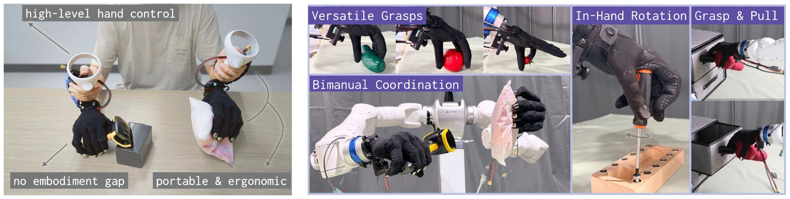

# DexPort: A Hand-Held Skill Interface for Dexterous Hand Data Collection
Official implementation of [DexPort](https://arxiv.org/abs/XXXX.XXXXX).

\[[Paper](https://arxiv.org/abs/2610.32969)\] \[[Website](https://amberxie88.github.io/dexport/index.html)\]



## Installation
```bash
python3.11 -m venv .venv && source .venv/bin/activate
pip install -e ".[collect]"   # or train, deploy, calib, wandb
```

Do the per-machine setup in [docs/usage.md](docs/usage.md#install) first: git-lfs before pip for
the Quest reader, CUDA torch for training and deployment, and the Marvin SDK for the Tianji arms.

## Hardware

[`hardware/`](hardware/) has the 3D-printed parts of the hand-held interface (STL, printed in PLA)
and the bill of materials, [`BOM.csv`](hardware/BOM.csv):

| part | files |
|---|---|
| handle | `handle_left.stl`, `handle_right.stl` |
| camera mount, Wuji 1 | `cam_mount_left.stl`, `cam_mount_right.stl` |
| camera mount, Wuji 2 | `cam_mount_left_wuji2.stl`, `cam_mount_right_wuji2.stl` |
| strap bracket | `strap_bracket.stl` |

## Training the Rotation Skill in Simulation

We train the in-hand rotation skill with PPO in Isaac Lab, which needs its own conda environment:

```bash
bash sim/install.sh            # conda env "isaaclab"
conda activate isaaclab
python sim/train.py --headless
```

`checkpoints/rotation_skill/model.pt` is a random placeholder: replace it with a trained actor
before collecting screwdriver demonstrations. See [sim/README.md](sim/README.md).

## Data Collection

Run the collector with one of the task configs in `configs/collect/` (`wuji1_pnp`,
`wuji1_screwdriver`, `wuji2_drawer`, `wuji2_scan`):

```bash
python -m dexport.collect --config configs/collect/wuji1_pnp.yaml
```

On the Quest controllers, B starts and stops recording and Y discards the episode; each run saves
a session to `data/<MMDD_HHMM>_<task>/`. The full controls are in
[docs/usage.md](docs/usage.md#1-collect-demonstrations).

## Policy Training

Split the sessions into train and test, then train a diffusion policy with one of the presets
(`pnp`, `pnp_cotrain`, `screwdriver`, `drawer`, `scan`):

```bash
python scripts/make_split.py --sessions data/*_pnp --out data/splits/pnp --test-count 10
python -m dexport.minbc.train pnp --data-dir data/splits \
    --train-data pnp/train/trajectories.zarr --test-data pnp/test/trajectories.zarr
```

`python -m dexport.minbc.train <preset> --help` lists a preset's fields; any of them can be
overridden on the command line.

## Real-World Deployment

Calibrate the controller-to-flange mount of the policy's arm (A is left, B is right), paste the
fit into `dexport/deploy/config.py`, then run the policy on the Tianji arms:

```bash
python -m dexport.calib.capture --mode jog --arm B --out data/calib/arm_b.npz
python -m dexport.calib.solve --npz data/calib/arm_b.npz   # prints the QUEST_TO_* lines to paste
python -m dexport.deploy --ckpt outputs/pnp
```

Before the first run on a rig, see [docs/usage.md](docs/usage.md#4-calibrate-the-controller-to-flange-mount)
for the calibration procedure, `--spacer` and replaying a recording.

## Citation

```bibtex
@misc{xie2026dexport,
  title  = {DexPort: A Hand-Held Skill Interface for Dexterous Hand Data Collection},
  author = {Amber Xie and Jiawei Fu and Xiaofeng Guo and Carlo Sferrazza and Guanya Shi and Haozhi Qi},
  year   = {2026},
  url    = {https://amberxie88.github.io/dexport/index.html}
}
```

## Security

See [CONTRIBUTING](CONTRIBUTING.md#security-issue-notifications) for more information.

## License

This code is released under the [Apache License 2.0](LICENSE). Third-party notices are in
[THIRD_PARTY_NOTICES.md](THIRD_PARTY_NOTICES.md).
